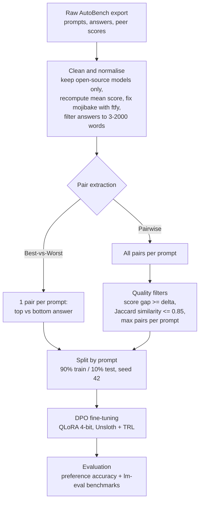

# Fine-Tuning LLMs via Peer-Generated Training Data

[](https://github.com/lollo-salis/Fine-Tuning-LLMs-via-Peer-Generated-Training-Data/actions/workflows/tests.yml)
[](LICENSE)


Can a language model be aligned **without any human annotation**, using preferences produced by *other* language models?
This repository contains the code behind my BSc thesis in *Mathematics for Artificial Intelligence* (Sapienza University of Rome, supervisor: Prof. Fabrizio Silvestri), which tests the idea end to end:

1. take the scores that models assign to each other's answers in the **[AutoBench](https://arxiv.org/abs/2510.22593)** reciprocal peer-assessment benchmark,
2. turn them into `(prompt, chosen, rejected)` preference datasets,
3. fine-tune small open models (**Gemma 2 2B Instruct**, **Qwen 2.5 0.5B Instruct**) with **Direct Preference Optimization (DPO)** on a single free Kaggle T4 GPU (QLoRA via Unsloth),
4. evaluate on a held-out preference test set and on public benchmarks.

> 📄 Full write-up: [English](docs/thesis_en.pdf) · [Italiano](docs/thesis_it.pdf)

> 🔒 **About the data.** The AutoBench export behind this work was shared privately by the AutoBench authors, so **neither the raw data nor the derived preference datasets are published here**. The code, hyper-parameters and results are fully documented, and the pipeline runs on any scored-answers CSV (see [Reproducing this work](#reproducing-this-work)). Notebook outputs are cleared for the same reason; all results are reported in [`results/results.md`](results/results.md).

## TL;DR

* **Feasible:** a complete pipeline from raw peer-assessment scores to a DPO-trained model works on free hardware and without human labels.
* **Largely non-destructive:** in most configurations, general benchmarks (ARC, HellaSwag, Winogrande, TruthfulQA, MMLU) move by less than ~1 point. The exception is the strictest-pair Qwen run (delta >= 0.5), which lost 2-5 points on ARC, TruthfulQA and IFEval after 1-2 epochs.
* **Modest gains:** with only 313-6,097 preference pairs and LoRA adapters, effects are small - mostly within the noise of the evaluation (see [caveats](#caveats)).
* **Data quality seems to matter:** stricter pair selection (larger score gap between chosen and rejected) gave a slightly higher preference accuracy than using more but weaker pairs - though the effect is small, and in that run it came with a drop on some external benchmarks.
* **A methodological finding:** raw (summed) log-probability preference accuracy is biased by answer length; length-normalising it fixes most - but not all - of the gap for the 0.5B model, which I discuss as a possible *typicality bias* (thesis, Section 6.4).

## Method



The split is done **by prompt** (never by pair) so that pairs derived from the same prompt cannot leak from train into test.

### Datasets built from AutoBench

| Dataset | Strategy | Triples | Mean gap | Median gap |
|---|---|---|---|---|
| Best-vs-Worst | one extreme pair per prompt | 313 | 1.746 | 1.500 |
| Pairwise, delta >= 0.3 | all pairs, max 20 / prompt | 6,097 | 1.272 | 1.067 |
| Pairwise, delta >= 0.5 | all pairs, max 10 / prompt | 3,058 | 1.499 | 1.300 |

All come from 313 unique prompts and only use answers and scores from the 20 open-source models in the AutoBench run (scores on a 1-5 scale). "Gap" is the difference between the mean peer scores of the chosen and the rejected answer.

### Training setup

|---|---|
| Algorithm | DPO (sigmoid loss), beta = 0.1 |
| Adapter | QLoRA - 4-bit NF4 base, LoRA r = 16, alpha = 16, dropout 0, all attention + MLP projections |
| Optimiser | AdamW 8-bit, lr 5e-5, cosine schedule, warmup 10% |
| Batch | 2 per device x 8 gradient accumulation = 16 |
| Epochs | 1 (E1-E3); E4 trained for up to 5 epochs with a checkpoint saved at each epoch |
| Precision | FP16 (T4 has no BF16) |
| Max sequence length | 2000 tokens (Qwen) / 850 tokens (Gemma, memory-bound) |
| Hardware | 1x NVIDIA Tesla T4 (14.6 GB), Kaggle notebooks |

## Results

Full tables: [`results/results.md`](results/results.md).

**Preference accuracy on the held-out test split** (length-normalised; raw values in the full tables):

| Model | Dataset | Base | After DPO |
|---|---|---|---|
| Gemma 2 2B | Best-vs-Worst | 67.74 | 67.74 |
| Qwen 2.5 0.5B | Best-vs-Worst | 38.71 | 38.71 |
| Qwen 2.5 0.5B | Pairwise delta >= 0.3 | 40.94 | 40.94 |
| Qwen 2.5 0.5B | Pairwise delta >= 0.5 | 41.56 | 42.52 (2 epochs) |

**External benchmarks** (zero-shot, accuracy %; Qwen 2.5 0.5B + Pairwise delta >= 0.3):

| Benchmark | Base | DPO | Delta |
|---|---|---|---|
| ARC-Challenge | 36.40 | 36.40 | 0.00 |
| HellaSwag | 48.00 | 47.20 | -0.80 |
| Winogrande | 59.20 | 59.20 | 0.00 |
| TruthfulQA MC2 | 42.37 | 42.47 | +0.10 |
| MMLU | 45.92 | 46.24 | +0.32 |
| IFEval | 20.00 | 18.40 | -1.60 |

### Caveats

* External benchmarks use `lm-eval` with `limit = 250` examples per task, i.e. a standard error of roughly +-3 points. Most differences above are **not statistically significant**; I report them as "no measurable degradation", not as improvements.
* The preference test splits are small (31 held-out prompts), so a change of one prompt moves accuracy by ~3 points.
* Preference accuracy below 50% for Qwen 2.5 0.5B is an artefact of how log-probabilities of long, stylistically distinctive answers are scored by a very small model - not evidence that the model "prefers the worse answer" (thesis, Section 6.4).
* The AutoBench preference signal comes from model judges of comparable capability; known judge biases (verbosity, self-preference) may propagate into the data.

## Repository structure

```
.
├── notebooks/
│   ├── 01_create_dpo_dataset.ipynb     # AutoBench scores -> DPO datasets
│   ├── 02_finetune_qwen_dpo.ipynb      # Qwen 2.5 0.5B Instruct (DPO / ORPO switch)
│   ├── 03_finetune_gemma_dpo.ipynb     # Gemma 2 2B Instruct
│   └── 04_benchmark_base_vs_dpo.ipynb  # preference accuracy + lm-eval, base vs DPO
├── src/build_dataset.py                # CLI/library version of notebook 01
├── tests/                              # unit tests for the dataset pipeline (synthetic data)
├── results/results.md                  # all result tables from the thesis
├── docs/thesis_en.pdf                  # full thesis (English)
├── docs/thesis_it.pdf                  # full thesis (Italian, original)
└── .github/workflows/tests.yml         # CI: runs the tests on every push
```

## Reproducing this work

**The AutoBench export used here was shared privately and is not redistributed**, so the preference datasets and trained adapters are not included. What you can do:

* **Run the tests** (no data or GPU needed) to see the dataset pipeline in action on synthetic scores:
  ```bash
  git clone https://github.com/lollo-salis/Fine-Tuning-LLMs-via-Peer-Generated-Training-Data.git
  cd Fine-Tuning-LLMs-via-Peer-Generated-Training-Data 
  pip install -r requirements.txt
  pytest
  ```
* **Build datasets from your own scored answers.** Any CSV with columns `question`, `answer`, `average_rank_os`, `model_name` works (several answers per question, each with a quality score):
  ```bash
  python -m src.build_dataset --input my_scores.csv --output data/dpo_pairwise.parquet \
      --strategy pairwise --min-delta 0.5 --max-pairs-per-prompt 10
  ```
  This writes `*_train.parquet`, `*_test.parquet` and `*_with_delta.parquet`.
* **Train and evaluate** on Kaggle (free T4): upload the notebooks in `notebooks/`, point the path placeholders (`<your-...>`) at your data, and run them in order. Gemma is a gated model: add a Kaggle secret `HF_TOKEN` and accept the licence on its Hugging Face page.

## Limitations and future work

Only two small models and one data source were studied; training used LoRA on a 14.6 GB GPU, which forced sequence truncation (850 tokens) for Gemma; no comparison with human-annotated preferences was made. Natural next steps: larger preference sets, larger models, better pair-selection (e.g. judge-agreement weighting), a direct test of the typicality hypothesis, and a head-to-head against human-labelled data.

## Citation

If this is useful to you, please cite the thesis (see [`CITATION.cff`](CITATION.cff)) and the AutoBench paper:

> Loi, Muià, Siciliano, Trappolini, Crisà, Kruger, Silvestri. *AutoBench: Automating LLM Evaluation through Reciprocal Peer Assessment.* arXiv:2510.22593, 2025.

## License

Code: [MIT](LICENSE). The thesis PDFs in `docs/` is © 2026 Lorenzo Salis, all rights reserved.

## Author

**Lorenzo Salis** - BSc Mathematics for Artificial Intelligence, Sapienza University of Rome.
[LinkedIn](https://www.linkedin.com/in/lorenzo-salis-b0a983435) · [Email](mailto:lorenzo.salis04@gmail.com) · [GitHub](https://github.com/lollo-salis)
